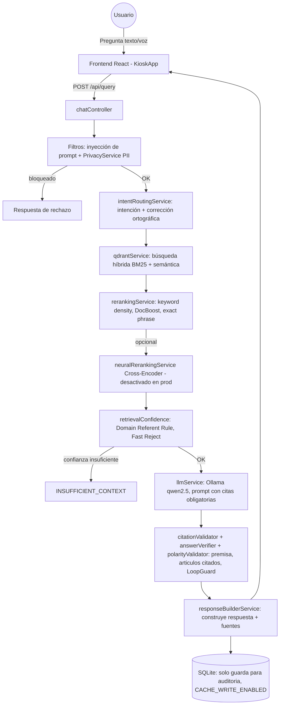

# Documentación Técnica de Arquitectura: Asistente RRHH Plastitec (IA)

Este documento detalla la arquitectura, el funcionamiento interno y la integración de servicios del **Asistente de Recursos Humanos de Plastitec** ("RITA"), una solución de IA conversacional 100% local (sin dependencias cloud de inferencia) para automatizar consultas sobre el Reglamento Interno de Trabajo (RIT) y políticas corporativas.

> Nota: este documento reemplaza una versión anterior que describía una arquitectura basada en NotebookLM vía MCP. Esa arquitectura fue sustituida por el pipeline RAG local (Qdrant + Ollama) descrito aquí.

---

## 1. RESUMEN GENERAL DEL SISTEMA

### Descripción del Proyecto
El **Asistente RRHH Plastitec** es una aplicación web (kiosco táctil + navegador) que permite a los colaboradores hacer preguntas en lenguaje natural (texto o voz) sobre el RIT y procedimientos internos (SST, BPM, código de ética, control de acceso). Todo el procesamiento de IA corre **localmente** (sin enviar datos a servicios externos de inferencia): retrieval vectorial + LLM se ejecutan en la misma máquina/servidor.

### Objetivo Principal
Responder con precisión y citando la fuente exacta (documento/artículo), evitando alucinaciones, y escalando a RRHH (anexo 142 / buzón de sugerencias) cuando la información no está en el corpus documental.

### Arquitectura General (Alto Nivel)
Patrón **Cliente-Servidor (SPA + API REST)** con un pipeline RAG híbrido de 5 capas:
- **Frontend**: SPA React 19 + Vite, tema de kiosco táctil (`KioskApp`), con reconocimiento/síntesis de voz nativos del navegador.
- **Backend**: API REST (Node.js + Express 5) que orquesta retrieval, reranking, generación y validación de citas.
- **Vector DB**: Qdrant — búsqueda híbrida (BM25 + semántica) sobre el corpus documental.
- **LLM**: Ollama (modelo local, sin llamadas a APIs externas de IA generativa).
- **Caché SQLite**: solo auditoría/analítica (no sirve respuestas) — ver sección 4.

---

## 2. ARQUITECTURA GENERAL

### Diagrama Lógico de Flujo (pipeline RAG, `services/ragService.js` v7.1)

### Las 5 capas del pipeline (de más rápida a más costosa)
1. **Resolución de intención local** (`intentRoutingService`, reglas, <5ms).
2. **Caché de sesión en RAM** (`QuickCache`, dentro del propio navegador/sesión).
3. **SQLite (solo lectura si `CACHE_READ_ENABLED=true`)** — actualmente **desactivada** para responder (ver sección 4); cada consulta va fresca al RAG.
4. **Qdrant (búsqueda híbrida) + reranking + Cross-Encoder opcional** — 2-10s.
5. **Ollama (generación) + validación de citas** — construcción final de la respuesta.

---

## 3. BACKEND (Node.js + Express)

### Estructura de Proyecto
- `server.js` — punto de entrada, registra rutas y arranca el servidor.
- `routes/` — `chatRoutes`, `adminRoutes`, `analyticsRoutes`, `feedbackRoutes`, `systemRoutes`.
- `controllers/` — `chatController`, `adminController`, `analyticsController`, `feedbackController`, `systemController`.
- `services/` — lógica de negocio (ver sección 5).
- `config/` — `corpusFiles.js` (qué archivos de `/docs` son corpus), `corporateVocabulary.json`, `slangRules.js`, `glosario_jerga_colombiana.json`, `systemMessages.js`.
- `utils/` — `logger.js`, `security.js`, `textProcessor.js`, `sentenceKey.js`, `ollamaGate.js`, `state.js`.
- `dist/` — frontend compilado (build de producción, servido de forma estática).

### Endpoints de la API
| Método | Ruta | Función |
| :--- | :--- | :--- |
| `POST` | `/api/query` | Endpoint principal — ejecuta el pipeline RAG completo. |
| `POST` | `/api/reset` | Reinicia la conversación/sesión actual. |
| `GET` | `/api/health` | Estado del servidor (`ready` / `initializing`) y motor activo. |
| `GET` | `/api/system-status` | Métricas de sistema (uptime, memoria, plataforma). |
| `GET` | `/api/knowledge-version` | Versión actual del corpus indexado. |
| `GET` | `/api/documents` | Lista de documentos disponibles en el corpus. |
| `POST` | `/api/verify-pin` | Valida el PIN de administrador (hash+salt, server-side). |
| `POST` | `/api/bump-knowledge-version` | Fuerza una nueva versión de conocimiento (admin). |
| `POST`/`GET` | `/api/analytics`, `/api/analytics/quality` | Registro y reporte de calidad de respuestas. |
| `GET`/`POST` | `/api/system-errors`, `/api/system-errors/resolve` | Errores reportados por el frontend. |
| `POST` | `/api/report-error` | El frontend reporta errores de micrófono/red/IA. |
| `POST`/`GET` | `/api/suggestions` | Buzón de sugerencias (persistido en SQLite). |
| `POST`/`GET` | `/api/rate-answer`, `/api/rate-answer/stats` | Feedback de respuestas (😞/😐/😊). |

### Flujo de `/api/query` (`chatController.js`)
1. **Filtro de inyección de prompt**: blocklist de patrones (`ignora tus instrucciones`, `jailbreak`, etc.) — rechazo inmediato sin tocar el LLM.
2. **Filtro de privacidad** (`privacy.js`): reglas contextuales (no solo keywords) para detectar solicitudes de información sensible/PII.
3. **Delegación a `ragService.query()`** — ejecuta el pipeline de 5 capas descrito arriba.
4. **Registro en SQLite** (si `CACHE_WRITE_ENABLED=true`): guarda pregunta, respuesta, confianza e IP — **solo para auditoría**, nunca se vuelve a leer para responder.
5. **Respuesta al frontend**: texto + fuentes citadas + metadatos de retrieval (score, tipo de búsqueda, boost aplicado).

---

## 4. BASE DE DATOS (SQLite — `hr_cache.db`)

### Rol actual: auditoría, NO caché de respuestas
Desde 2026-08-14 la lectura y escritura son flags **independientes**:
- `CACHE_READ_ENABLED=false` (actual) → **nunca** se responde desde una entrada guardada; toda consulta va fresca al pipeline RAG. Se desactivó porque el Coeficiente de Dice hacía match entre preguntas no equivalentes y congelaba respuestas de baja calidad.
- `CACHE_WRITE_ENABLED=true` (actual) → cada respuesta con contenido real se guarda en `knowledge_base` para análisis/auditoría posterior (confianza, fuente, IP).

### Tabla `knowledge_base` (campos principales)
| Campo | Tipo | Función |
| :--- | :--- | :--- |
| `question_original` / `question_normalized` | TEXT | Pregunta tal cual y versión normalizada (para similitud Dice, hoy solo informativa). |
| `answer` | TEXT | Respuesta generada por el RAG. |
| `usage_count` | INTEGER | Veces que se ha visto esa pregunta (métrica, no gatilla caché). |
| `knowledge_version` | INTEGER | Versión del corpus con la que se generó la respuesta. |
| `confidence` | REAL | Score de confianza del retrieval/LLM al momento de responder. |

### Otras tablas
- **Sugerencias** (buzón) y **Feedback de respuestas** (rating 😞/😐/😊), consumidas por `feedbackController`/`feedbackRoutes`.

---

## 5. RAG: QDRANT + OLLAMA (reemplaza la integración con NotebookLM)

### Vector DB — Qdrant (`services/qdrantService.js`)
- Corre localmente en `http://localhost:6333`. **Importante operativo**: debe iniciarse con working directory `C:\AIV2` (no `C:\AIV2\qdrant`), de lo contrario crea un storage vacío en la ruta equivocada.
- **Colección activa**: `plastitec_docs_bge` (embeddings `bge-m3`, 1024 dimensiones, ~478 puntos). Existen colecciones de respaldo (`plastitec_docs_p0`, `plastitec_docs_pre_p0`) para rollback.
- Búsqueda **híbrida**: BM25 (texto, con ascii_folding para tildes) + semántica (vector), fusionadas (RRF) y luego re-rankeadas.

### Embeddings (`services/embeddingsService.js`)
- Modelo activo: `bge-m3` servido por Ollama (`OLLAMA_EMBED_MODEL=bge-m3`, `LOCAL_EMBEDDING_DIMENSION=1024`).

### LLM — Ollama (`services/llmService.js`)
- Modelo activo: **qwen2.5:latest** (7B, Q4_K_M) — reemplazó a `llama3.2:3b` (piloto 2026-10-09: alucinaciones 44→13 de 150 preguntas).
- `LLM_PROMPT_STYLE=chat` (usa `/api/chat` de Ollama), `OLLAMA_NUM_CTX=8192`, `LLM_SKIP_REASONING=true`.
- **LoopGuard**: aborta el streaming si una oración se repite (anti-alucinación por bucle).
- **Reranking neuronal** (Cross-Encoder `bge-reranker-base`) implementado pero **desactivado en producción** (`ENABLE_NEURAL_RERANKER=false`), solo para benchmarking.

### Corpus documental (`/docs`, definido en `config/corpusFiles.js`)
- Archivos que SÍ se indexan: los `I-RH-*.md` (inducción, BPM, SST, zonas de acceso, código de ética), `RIT_PLASTITEC_01_DE_JULIO_2026_VF.md`, `RRHH_IA.docx`, `SST_IA.docx`.
- `EXCLUDED_FILES` excluye documentos derogados (RIT anterior y su comunicado).
- **Nota post-limpieza (oct. 2026)**: la documentación propia del proyecto (manuales técnicos, contexto, presentaciones) se movió a `/project-docs` para que **nunca** se indexe por error como si fuera contenido normativo de RRHH — antes de ese cambio, archivos de ese tipo en `/docs` sí habrían sido ingeridos al corpus.

### Validación anti-alucinación
- **`citationValidator.js`**: verifica que los artículos/documentos citados existan realmente en el corpus; recorta "ecos" de ejemplos del prompt cuando no aplican a la pregunta.
- **`answerVerifier.js` / `polarityValidator.js`**: chequeo de premisa (la pregunta debe estar anclada en el contexto recuperado) y de polaridad (no invertir sentido afirmativo/negativo).
- **`retrievalConfidence.js`**: "Domain Referent Rule" — una consulta sin ningún término de dominio HR se penaliza (`NO_DOMAIN_REFERENT`); confianza por debajo de umbral → `INSUFFICIENT_CONTEXT` en vez de alucinar.

---

## 6. FRONTEND (React 19 + Vite + Tailwind 4 + Framer Motion)

### Shell principal: `KioskApp.jsx`
Reemplazó al antiguo `VoiceChat.jsx` / `ChatShell` de 2 paneles (rediseño 2026-10-09, tema claro, kiosco táctil). Vistas disponibles (`src/components/kiosk/`):
- `HomeView` — pantalla de bienvenida ("Pregúntale a RITA" + accesos directos).
- `ChatView` — pregunta → respuesta (texto o voz), feedback 😞/😐/😊, botón "Escuchar"/"Copiar".
- `DocumentsView`, `FaqView`, `GuideView` — documentos disponibles, preguntas frecuentes, guía de uso.
- `SuggestionsView` — buzón de sugerencias.
- `AboutRitaModal` — modal "¿Qué es RITA?".

### Auto-reinicio por inactividad (kiosco compartido)
Si hay una pregunta/respuesta o un borrador de sugerencia en pantalla y nadie interactúa en **30 segundos**, se muestra un modal "¿Sigues ahí?" con cuenta regresiva de 10s antes de reiniciar a Inicio — así la siguiente persona no hereda la consulta anterior. Solo se activa en las vistas `chat` y `suggestions` (no en Inicio/Documentos/FAQs/Guía).

### Acceso Admin
5 clics en el logo superior → modal de PIN → `/api/verify-pin` (verificación server-side, hash+salt) → abre el dashboard (`?dashboard=true` → `AnalyticsDashboard.jsx`) en una pestaña nueva.

### Compatibilidad
- Mobile-first / táctil, pensado para tablets en kioscos fijos.
- Reconocimiento de voz (Web Speech API) y síntesis de voz (TTS nativo del navegador, voz `es-MX`).
- PWA instalable (`manifest.json`, service worker `sw.js`).

---

## 7. ADMIN DASHBOARD (`AnalyticsDashboard.jsx`)

- **Seguridad**: PIN validado solo en backend (`ADMIN_PIN_HASH`/`ADMIN_PIN_SALT`); el hash nunca se expone en el bundle de frontend.
- **Funcionalidades**: métricas de uso/calidad (`/api/analytics/quality`), errores reportados por el frontend, estado del sistema (`/api/system-status`), forzar nueva versión de conocimiento (`/api/bump-knowledge-version`), ver sugerencias y ratings de respuestas.

---

## 8. CONFIGURACIÓN Y VARIABLES CLAVE (`.env`)

| Variable | Valor actual | Función |
| :--- | :--- | :--- |
| `PORT` | 3000 | Puerto del backend. |
| `ALLOWED_ORIGINS` | lista de orígenes | CORS whitelist. |
| `QDRANT_URL` / `QDRANT_COLLECTION` | `http://localhost:6333` / `plastitec_docs_bge` | Vector DB activo. |
| `OLLAMA_URL` / `OLLAMA_MODEL` | `http://localhost:11434` / `qwen2.5:latest` | LLM activo. |
| `OLLAMA_EMBED_MODEL` / `LOCAL_EMBEDDING_DIMENSION` | `bge-m3` / `1024` | Modelo de embeddings. |
| `LLM_PROMPT_STYLE` / `OLLAMA_NUM_CTX` | `chat` / `8192` | Modo de prompting y ventana de contexto. |
| `CACHE_READ_ENABLED` / `CACHE_WRITE_ENABLED` | `false` / `true` | SQLite solo audita, no responde (ver sección 4). |
| `MAX_QUERY_LENGTH` | 200 | Límite de caracteres por consulta. |
| `RATE_LIMIT_WINDOW_MS` / `RATE_LIMIT_MAX_REQUESTS` | 900000 / 100 | Rate limiting del backend. |
| `ENABLE_NEURAL_RERANKER` | `false` | Cross-Encoder desactivado en producción. |
| `ADMIN_PIN_HASH` / `ADMIN_PIN_SALT` | — | Credencial de acceso admin (server-side only). |

---

## 9. FLUJO COMPLETO DE UNA PREGUNTA (ejemplo real, verificado)

1. **Usuario**: "Horario de trabajo".
2. **Frontend**: `POST /api/query` desde `ChatView`.
3. **Backend**: pasa filtros de inyección/privacidad → `ragService.query()`.
4. **Retrieval**: Qdrant devuelve chunks del RIT con score `bm25+exact_phrase` y `semantic`, con `DocBoost` aplicado por coincidencia de nombre de archivo.
5. **Confianza**: pasa el umbral (ejemplo real: `confidence=0.963`).
6. **LLM**: Ollama (qwen2.5) genera la respuesta citando el RIT.
7. **Validación**: `citationValidator` confirma que el artículo/documento citado existe en el corpus.
8. **Respuesta**: texto + fuente (`RIT_PLASTITEC_01_DE_JULIO_2026_VF.md`) + se guarda en SQLite solo para auditoría.

---

## 10. ESTADO ACTUAL Y RECOMENDACIONES (octubre 2026)

- **Madurez**: pipeline RAG local estable, verificado end-to-end tras limpieza de repositorio (oct. 2026): Qdrant, Ollama y backend responden correctamente, `storage/` (datos de Qdrant) y `hr_cache.db` intactos.
- **Fortalezas**: respuestas citadas y verificables, sin dependencia de servicios de IA externos, guardrails anti-alucinación en varias capas (confianza, premisa, citas, LoopGuard).
- **Riesgos conocidos**:
  - Kaspersky (antivirus) ha interferido con archivos de Qdrant (bloqueo de renombrado de segmentos) y, en al menos una ocasión, puso en cuarentena documentos `.docx` del corpus — se recomienda excluir `C:\AIV2` del escaneo en tiempo real.
  - El hash/salt del PIN de administrador quedó expuesto históricamente en un backup commiteado (ya eliminado del repo, pero persiste en el historial de git) — se recomienda rotar el PIN.
  - Retrieval aún falla en consultas de jerga/indirectas (ver benchmarks históricos): principal palanca pendiente es chunking por numeral en artículos largos del RIT.
- **Recomendaciones**:
  - Mantener `/docs` reservado exclusivamente al corpus normativo (nunca agregar documentación técnica ahí; usar `/project-docs`).
  - No reactivar `CACHE_READ_ENABLED` sin revisar antes la lógica de similitud (Dice coefficient) para evitar respuestas cruzadas entre preguntas distintas.
  - Evaluar el Cross-Encoder (`ENABLE_NEURAL_RERANKER`) en benchmark antes de considerarlo para producción.

---
*Documento actualizado — octubre 2026, reflejando la infraestructura real tras la migración a Qdrant + Ollama y la limpieza de repositorio.*
